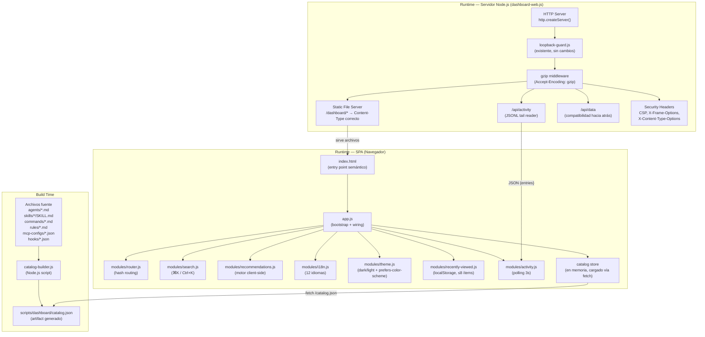
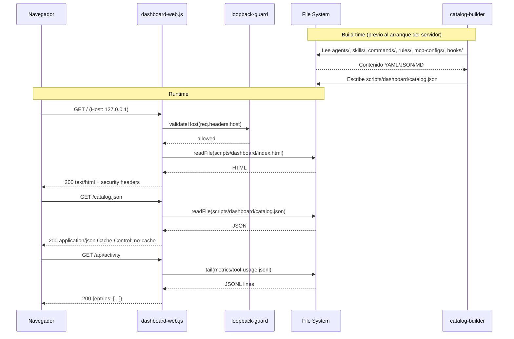
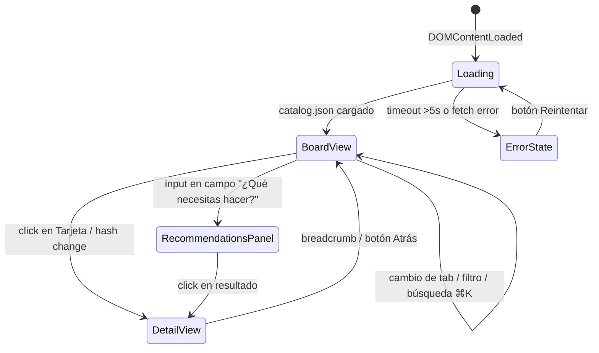
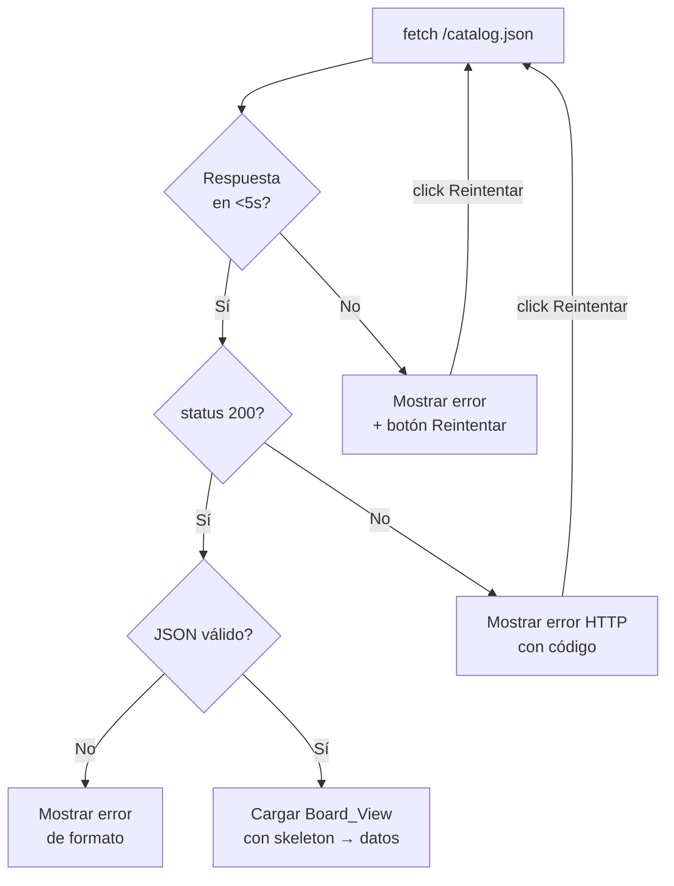

# Diseño Técnico — Visual Agent Dashboard

## Visión General

El Visual Agent Dashboard es una refactorización integral del servidor `scripts/dashboard-web.js` existente (~1108 líneas). El sistema actual embebe HTML, CSS y JavaScript en un template string gigante dentro del servidor Node.js. El objetivo es separar responsabilidades, rediseñar la interfaz hacia un tablero tipo Trello y añadir funcionalidades clave: sistema de recomendaciones client-side, sección "Cómo usarlo", accesibilidad WCAG 2.2 AA, soporte completo de español y rendimiento Lighthouse ≥85/≥90.

**Principios de diseño:**
- El servidor Node.js se limita a HTTP + serving de estáticos + APIs ligeras
- La SPA vanilla JS carga datos desde `catalog.json` estático, generado en build-time
- Sin dependencias de frameworks de frontend ni TypeScript — solo JS/CSS/HTML nativos
- Los módulos de `scripts/lib/` existentes no se modifican
- Las medidas de seguridad existentes (Loopback_Guard, enmascarado de env vars) se preservan íntegramente

---

## Arquitectura

### Diagrama de Capas



### Diagrama de Flujo de Peticiones



### Flujo de Navegación SPA



---

## Componentes e Interfaces

### `scripts/catalog-builder.js`

Script Node.js ejecutado en build-time. Lee archivos fuente y genera `catalog.json`.

```js
// Interfaz pública (exports)
module.exports = {
  buildCatalog(root = ROOT_DEFAULT),   // función principal → CatalogData
  parseFrontmatterYaml(content),       // usa js-yaml → FrontmatterResult
  maskEnvVars(obj),                    // enmascara ${VAR} y process.env.VAR → "[env]"
  writeAtomicJson(filePath, data),     // escribe con tmp + rename atómico
};
```

**Comportamiento ante errores:** cada archivo fuente se procesa dentro de su propio `try/catch`. Si el frontmatter YAML de un archivo está malformado, se emite `console.warn('[ECC] catalog-builder: malformed frontmatter in <path>')` y se continúa con el siguiente archivo. El proceso nunca aborta.

### `scripts/dashboard-web.js` (refactorizado)

Servidor HTTP puro. Responsabilidades reducidas a:
1. Loopback guard (existente sin cambios via `scripts/lib/loopback-guard.js`)
2. Servir archivos estáticos desde `scripts/dashboard/`
3. Middleware de gzip (compresión para text/html, text/css, application/javascript, application/json)
4. Security headers en todas las respuestas (CSP, X-Frame-Options, X-Content-Type-Options)
5. Endpoints `/api/activity` y `/api/data` (compatibilidad hacia atrás)
6. SPA fallback: cualquier ruta no-estática y no-API → `index.html`
7. Rechazo de path traversal (`../`, `..\`) con HTTP 400
8. Validación de `ECC_DASHBOARD_HOST` al inicio del proceso

### `scripts/dashboard/app.js`

Entry point de la SPA. Responsable del bootstrap:
- Importa todos los módulos vía `import` ES modules estático
- Inicializa el catálogo store (fetch a `/catalog.json`)
- Muestra skeleton loaders mientras carga (`requestAnimationFrame` para actualizaciones DOM)
- Conecta el router, i18n, theme y recently-viewed al estado global
- Expone el estado global como objeto inmutable en módulo

### `scripts/dashboard/modules/router.js`

Hash routing client-side. Escucha `hashchange` y `popstate`.

```js
// Rutas soportadas
const ROUTES = {
  '':               renderBoardView('agents'),
  '/agents':        renderBoardView('agents'),
  '/skills':        renderBoardView('skills'),
  '/commands':      renderBoardView('commands'),
  '/rules':         renderBoardView('rules'),
  '/mcps':          renderBoardView('mcps'),
  '/hooks':         renderBoardView('hooks'),
  '/activity':      renderBoardView('activity'),
  '/agents/:name':  renderDetailView('agents', name),
  '/skills/:name':  renderDetailView('skills', name),
  '/commands/:name':renderDetailView('commands', name),
  '/rules/:lang':   renderDetailView('rules', lang),
  '/mcps/:file':    renderDetailView('mcps', file),
  '/hooks/:id':     renderDetailView('hooks', id),
  '*':              render404Panel(),
};

// Interfaz pública (ES module exports)
export function navigate(hash);
export function getCurrentRoute();           // → { pattern, params }
export function onRouteChange(callback);     // registra callback
```

### `scripts/dashboard/modules/search.js`

Búsqueda con atajo ⌘K / Ctrl+K.

```js
export function initSearch(catalog);
export function getSearchSuggestions(query, catalog);
// Retorna ≤8 resultados, latencia ≤100ms
// Debounce de 100ms en input del usuario
// Normaliza: toLowerCase() + strip acentos (NFD + /\p{M}/gu)
```

### `scripts/dashboard/modules/recommendations.js`

Motor de recomendaciones client-side. Función pura, sin side effects ni llamadas de red.

```js
export function recommend(query, catalog);
// query: string (3-200 chars)
// catalog: CatalogData
// → RecommendationResult[], ≤10 ítems, ordenados por score desc, ≤50ms

// Scoring ponderado por tokens:
//   score += 3 * ocurrencias(token, nombre)
//   score += 2 * ocurrencias(token, keywords)
//   score += 1 * ocurrencias(token, descripción)
// Normalización: toLowerCase() + NFD decomposition + strip diacritics
```

### `scripts/dashboard/modules/i18n.js`

Internacionalización con 12 idiomas. Incluye bundle `es` completo.

```js
export function t(key, lang);
// Fallback: si clave no existe en lang → busca en 'en' → console.warn
// Si tampoco existe en 'en' → retorna la clave misma (nunca string vacía)

export function detectLanguage();
// Detecta navigator.language, normaliza a los 12 códigos soportados
// Fallback a 'en' si no hay match

export const SUPPORTED_LANGS = ['en','pt','zh','zht','ja','ko','tr','ru','vi','th','de','es'];
```

### `scripts/dashboard/modules/theme.js`

```js
export function initTheme();     // lee 'ecc_theme' en localStorage o prefers-color-scheme
export function toggleTheme();
export function getCurrentTheme(); // → 'dark' | 'light'
```

### `scripts/dashboard/modules/recently-viewed.js`

```js
export function addItem(item);
// Retorna nueva lista (inmutable) con item al inicio, sin duplicados, ≤8 ítems
// Persiste en localStorage 'ecc_recently_viewed'

export function getItems();    // → RecentItem[]
export function clearItems();
```

### `scripts/dashboard/modules/activity.js`

```js
export function startPolling(onUpdate);
// Polling a /api/activity cada 3000ms
// Usa requestAnimationFrame para actualizaciones del DOM
// Retorna función stopPolling()
```

---

## Modelos de Datos

### `CatalogData` — estructura de `catalog.json`

```json
{
  "version": "1",
  "generatedAt": "2024-01-01T00:00:00.000Z",
  "agents": [
    {
      "id": "code-reviewer",
      "name": "code-reviewer",
      "description": "Expert code review specialist...",
      "shortDescription": "Expert code review specialist.",
      "model": "claude-sonnet-5",
      "tools": ["Read", "Write"],
      "type": "reviewer",
      "keywords": ["review", "code", "quality"],
      "body": "...",
      "sourceFile": "agents/code-reviewer.md"
    }
  ],
  "skills": [
    {
      "id": "react-patterns",
      "name": "react-patterns",
      "description": "React 18/19 patterns...",
      "shortDescription": "React 18/19 patterns including hooks...",
      "category": "Frontend",
      "keywords": ["react", "hooks", "patterns"],
      "body": "...",
      "sourceFile": "skills/react-patterns/SKILL.md"
    }
  ],
  "commands": [
    {
      "id": "git-commit",
      "name": "/git-commit",
      "description": "...",
      "shortDescription": "...",
      "group": "Git & PR",
      "keywords": [],
      "body": "...",
      "sourceFile": "commands/git-commit.md"
    }
  ],
  "rules": [
    { "lang": "en", "files": ["coding-style.md", "security.md"] }
  ],
  "mcps": [
    {
      "file": ".mcp.json",
      "servers": [
        {
          "name": "github",
          "command": "npx",
          "args": ["@modelcontextprotocol/server-github"],
          "env": { "GITHUB_TOKEN": "[env]" },
          "type": "stdio"
        }
      ]
    }
  ],
  "hooks": [
    {
      "id": "quality-gate",
      "event": "PostToolUse",
      "matcher": "*",
      "description": "Run quality checks after tool use"
    }
  ]
}
```

**Campos calculados por el Catalog_Builder:**
- `shortDescription`: truncado de `description` a 120 caracteres con `…`
- `type` (agentes): inferido del nombre del archivo (`*-reviewer` → `reviewer`, `*-resolver` → `builder`, `*-architect` → `architect`, `*-security*` → `security`, demás → `other`)
- `category` (skills): del frontmatter `category`; si ausente → `"General"`
- `group` (commands): de la tabla de prefijos existente en `dashboard-web.js`
- `keywords`: del frontmatter `keywords` array; si ausente → array vacío
- Valores de env vars en `mcps[].servers[].env`: enmascarados → `"[env]"`

### `RecommendationResult`

```js
{
  item,           // CatalogItem (referencia al ítem del catálogo)
  score,          // number, suma ponderada de coincidencias de tokens
  matchedTokens,  // string[], tokens que generaron la coincidencia
  type            // 'agent' | 'skill' | 'command'
}
```

### `RecentItem`

```js
{
  id,     // string, identificador único del ítem
  type,   // 'agent' | 'skill' | 'command' | 'rule' | 'mcp' | 'hook'
  name,   // string, nombre legible
  hash    // string, e.g. "#/agents/code-reviewer"
}
```

### `AppState` — estado global en memoria (objeto inmutable, no mutado directamente)

```js
{
  catalog,          // CatalogData | null
  loading,          // boolean
  error,            // string | null
  activeTab,        // string (tab activo)
  viewMode,         // 'board' | 'list'
  theme,            // 'dark' | 'light'
  lang,             // string (código de idioma activo)
  recentlyViewed,   // RecentItem[]
  searchQuery,      // string
  recommendQuery    // string
}
```

---

## Correctness Properties

*Una propiedad es una característica o comportamiento que debe mantenerse cierto en todas las ejecuciones válidas del sistema — esencialmente, una declaración formal sobre lo que el sistema debe hacer. Las propiedades sirven como puente entre especificaciones legibles por humanos y garantías de correctitud verificables por máquinas.*

---

### Propiedad 1: Round-Trip de Parseo de Frontmatter

*Para cualquier* objeto de frontmatter válido serializable a YAML, ejecutar `parseFrontmatterYaml(yaml.dump(obj))` SHALL producir un objeto con valores equivalentes al original (mismos tipos, mismo contenido de campos). En términos de round-trip: `parseFrontmatterYaml(yaml.dump(fm)).description === fm.description` para todos los campos escalares del frontmatter.

**Valida: Requisitos 1.1, 9.1**

---

### Propiedad 2: Idempotencia del Motor de Recomendaciones

*Para cualquier* query de texto válida (3–200 caracteres) y cualquier estado del catálogo, llamar a `recommend(query, catalog)` dos veces consecutivas sobre los mismos argumentos SHALL producir arrays idénticos en contenido y orden: `JSON.stringify(recommend(q, c)) === JSON.stringify(recommend(q, c))`.

**Valida: Requisitos 5.2, 9.3**

---

### Propiedad 3: Agrupamiento Sin Pérdidas ni Duplicados

*Para cualquier* lista de ítems del catálogo (agentes, skills o comandos), aplicar la función de agrupamiento por categoría/tipo SHALL producir grupos tal que: (a) la unión de todos los grupos contiene exactamente los mismos ítems que la lista original, (b) ningún ítem aparece en más de un grupo, y (c) los ítems sin categoría conocida se asignan siempre al grupo "General" o "Otros".

**Valida: Requisitos 2.6, 2.7, 2.8**

---

### Propiedad 4: El Motor de Recomendaciones Nunca Lanza Excepciones

*Para cualquier* query de texto válida (3–200 caracteres, incluyendo caracteres especiales, Unicode, acentos y emojis) y cualquier catálogo válido de hasta 500 ítems, `recommend(query, catalog)` SHALL completar sin lanzar excepciones y SHALL retornar un array (potencialmente vacío) en ≤50ms.

**Valida: Requisitos 5.2, 5.9**

---

### Propiedad 5: Resultados del Recomendador Ordenados por Score Descendente

*Para cualquier* query y catálogo que produzcan al menos 2 resultados, los resultados retornados por `recommend(query, catalog)` SHALL estar ordenados de forma que `results[i].score >= results[i+1].score` para todo índice `i` válido en el array.

**Valida: Requisito 5.3**

---

### Propiedad 6: Conteo en Encabezado de Columna Coincide con Tarjetas Renderizadas

*Para cualquier* estado del catálogo y cualquier filtro aplicado, el número entero mostrado en el encabezado de cada columna del Board_View SHALL ser igual al número de elementos de tarjeta presentes en el DOM de esa columna en el mismo ciclo de renderizado. `columna.header.count === columna.cards.length` para toda columna visible.

**Valida: Requisitos 2.5, 2.10**

---

### Propiedad 7: Enmascarado Completo de Variables de Entorno

*Para cualquier* objeto de configuración de MCP que contenga valores que coincidan con los patrones `${NOMBRE}` o `process.env.NOMBRE`, aplicar `maskEnvVars(obj)` SHALL producir un nuevo objeto donde ningún valor hoja del árbol JSON retiene el patrón original — cada uno es reemplazado por la cadena literal `"[env]"`. El objeto original SHALL no ser mutado.

**Valida: Requisitos 1.8, 8.6**

---

### Propiedad 8: Catalog Builder Tolera Frontmatter Malformado Sin Abortar

*Para cualquier* combinación de N archivos fuente con frontmatter YAML válido y M archivos con frontmatter YAML malformado (M ≥ 1, N ≥ 0), `buildCatalog()` SHALL: (a) producir exactamente N ítems en el catálogo resultante, (b) emitir exactamente M llamadas a `console.warn` que contengan el nombre del archivo afectado, y (c) retornar sin lanzar excepciones.

**Valida: Requisitos 1.9, 9.8**

---

### Propiedad 9: Recently Viewed — Invariante de Estructura

*Para cualquier* secuencia de operaciones `addItem(item)` sobre la lista de Recently Viewed: (a) la longitud de la lista resultante SHALL ser `Math.min(ítems_con_id_distinto_visitados, 8)` — visitas repetidas al mismo `id` no incrementan el conteo, (b) el primer elemento SHALL ser siempre el `id` del ítem añadido más recientemente, y (c) ningún `id` de ítem aparece más de una vez en la lista (sin duplicados).

**Valida: Requisitos 3.6, 3.7**

---

### Propiedad 10: Fallback de Internacionalización

*Para cualquier* clave de traducción que exista en el bundle `en` pero no en el bundle `es`, llamar a `t(key, 'es')` SHALL retornar el valor del bundle `en` (nunca la clave en sí misma, nunca una cadena vacía) y SHALL emitir exactamente un `console.warn` que mencione la clave faltante.

**Valida: Requisitos 10.4, 10.5**

---

### Propiedad 11: Ponderación de Scoring — Nombre > Keywords > Descripción

*Para cualquier* token T y cualquier par de ítems donde el ítem A tiene T únicamente en su nombre y el ítem B tiene T únicamente en su descripción (sin presencia en nombre ni keywords), `recommend` SHALL asignar `score(A) > score(B)`. De forma equivalente, para T en keywords de A vs T solo en descripción de B, `score(A) > score(B)`.

**Valida: Requisitos 5.8, 9.2**

---

### Propiedad 12: Host Headers No-Loopback Siempre Rechazados

*Para cualquier* valor del header `Host` que no pertenezca al conjunto `{127.0.0.1, localhost, ::1, [::1]}`, el servidor SHALL responder con HTTP 400 (o 421) y SHALL nunca procesar el cuerpo de la petición ni ejecutar lógica de negocio.

**Valida: Requisitos 8.1, 1.6**

---

## Manejo de Errores

### Estrategia por Capa

#### Catalog Builder (Build Time)

| Condición | Comportamiento |
|-----------|---------------|
| Archivo no existe | `console.warn` + continuar con siguiente |
| YAML malformado | `console.warn` con nombre de archivo + omitir ítem + continuar |
| Directorio no encontrado | `console.warn` + retornar array vacío para ese tipo |
| Error de escritura de `catalog.json` | Lanzar error fatal, proceso termina con exit code 1 |
| `ECC_DASHBOARD_HOST` no loopback | Error fatal: `"[ECC] ECC_DASHBOARD_HOST must be loopback-only"` |

#### Servidor HTTP (Runtime)

| Condición | Respuesta HTTP |
|-----------|---------------|
| Host header inválido | 400 `{"error":"Forbidden host"}` |
| Origin header inválido | 403 `{"error":"Forbidden origin"}` |
| Path traversal detectado (`../`, `..\`) | 400 `{"error":"Bad request"}` |
| Archivo estático no encontrado | 404 para assets; `index.html` para rutas SPA |
| Error leyendo archivo estático | 500 + log en stderr |
| Error en `/api/activity` | 500 `{"error":"Internal server error"}` + log |
| Error en `/api/data` | 500 `{"error":"Internal server error"}` + log |
| URL malformada | 400 `{"error":"Bad request"}` |

#### SPA (Client-Side)

| Condición | Comportamiento UI |
|-----------|-----------------|
| `fetch /catalog.json` timeout (>5s) | Mensaje de error con botón Reintentar (aria-live="assertive") |
| `fetch /catalog.json` error HTTP | Mensaje con código HTTP + botón Reintentar |
| Hash route no encontrada | Panel 404: "Este ítem no fue encontrado" + enlace al Board_View |
| Clave de traducción faltante en idioma activo | Fallback a `en` + `console.warn` (sin interrupción al usuario) |
| `localStorage` no disponible | Degradación silenciosa: funciones de persistencia son no-ops |
| Error en Motor de Recomendaciones | Retorna `[]` sin lanzar excepción (Propiedad 4) |
| `navigator.clipboard` no disponible | Botón "Copiar" muestra "No disponible" durante 2s |
| YAML malformado en catálogo | El ítem es omitido del catálogo resultante |

### Diagrama de Flujo de Error — Carga del Catálogo



---

## Estrategia de Testing

### Stack de Testing

- **Runner:** `node:test` (nativo, ya configurado en el proyecto)
- **Cobertura:** `c8` (ya configurado en `package.json`, umbral 80%)
- **PBT:** loops manuales con generadores de datos (sin dependencias externas)
- **Mocking:** `node:test` mock utilities + fake objects para FS/HTTP

### Estructura de Tests

```
tests/
└── dashboard/
    ├── catalog-builder.test.js        # Unit + PBT
    ├── recommendations.test.js        # Unit + PBT
    ├── router.test.js                 # Unit
    ├── search.test.js                 # Unit + PBT
    ├── i18n.test.js                   # Unit + PBT
    ├── recently-viewed.test.js        # Unit + PBT
    ├── theme.test.js                  # Unit
    ├── activity.test.js               # Unit + mock fetch
    └── server-integration.test.js    # Integration (HTTP real)
```

### Tests de Propiedad (PBT Manual — mínimo 100 iteraciones)

El patrón estándar para todos los tests de propiedad:

```js
import { test } from 'node:test';
import assert from 'node:assert/strict';

// Feature: visual-agent-dashboard, Property 2: Idempotencia del Motor de Recomendaciones
test('Property 2: recommend es idempotente', () => {
  const ITERATIONS = 100;
  for (let i = 0; i < ITERATIONS; i++) {
    const query = generateRandomQuery();      // 3–200 chars, caracteres aleatorios
    const catalog = generateRandomCatalog();  // 0–500 ítems, contenido aleatorio
    const result1 = recommend(query, catalog);
    const result2 = recommend(query, catalog);
    assert.deepStrictEqual(result1, result2,
      `Falla en iteración ${i} con query="${query}"`);
  }
});
```

**Tag format:** `// Feature: visual-agent-dashboard, Property N: <descripción>`

### Cobertura Mínima por Módulo

| Módulo | Objetivo |
|--------|---------|
| `catalog-builder.js` | ≥80% líneas |
| `modules/recommendations.js` | ≥80% líneas |
| `modules/router.js` | ≥80% líneas |
| `modules/search.js` | ≥80% líneas |
| `modules/i18n.js` | ≥80% líneas |
| `modules/recently-viewed.js` | ≥80% líneas |
| `dashboard-web.js` (refactorizado) | ≥80% líneas |

### Tests Unitarios por Módulo

#### `catalog-builder.test.js`
- Parseo correcto de frontmatter YAML válido (strings, arrays, números)
- Frontmatter malformado: emite `console.warn`, omite ítem, continúa con el resto
- Enmascarado de `${VAR}` y `process.env.VAR` → `"[env]"`
- Serialización correcta a JSON con estructura `CatalogData`
- **PBT — Propiedad 1:** Round-trip de parseo (100 iteraciones)
- **PBT — Propiedad 8:** N válidos + M malformados → N ítems + M warnings (100 iteraciones)

#### `recommendations.test.js`
- Query vacía devuelve array vacío
- Ponderación: nombre(3x) supera descripción(1x) para el mismo término
- Resultados ordenados de mayor a menor score
- Máximo 10 resultados retornados
- **PBT — Propiedad 2:** Idempotencia (100 iteraciones)
- **PBT — Propiedad 4:** Sin excepciones para inputs válidos con Unicode/emojis (100 iteraciones)
- **PBT — Propiedad 5:** Orden por score descendente siempre (100 iteraciones)
- **PBT — Propiedad 11:** Ponderación nombre > keywords > descripción (100 iteraciones)

#### `router.test.js`
- Cada ruta hash conocida resuelve al handler correcto
- Rutas desconocidas disparan handler 404
- Extracción correcta de parámetros (`:name`, `:lang`, `:id`)
- Navegación programática actualiza `window.location.hash`

#### `search.test.js`
- Devuelve ≤8 resultados siempre
- Normaliza mayúsculas y acentos en queries
- **PBT — Requisito 3.2:** Para cualquier query y catálogo, `getSuggestions` retorna ≤8 ítems (100 iteraciones)

#### `i18n.test.js`
- `t(key, 'en')` devuelve traducción para todas las claves existentes
- `t(key, 'es')` devuelve texto en español para todas las claves del bundle `es`
- **PBT — Propiedad 10:** Para cualquier clave existente en `en` pero no en `es`, `t(key, 'es')` retorna valor de `en` y emite `console.warn` (100 iteraciones)

#### `recently-viewed.test.js`
- `addItem` coloca el ítem al inicio
- La lista nunca supera 8 ítems
- No hay duplicados tras múltiples llamadas con el mismo ítem
- **PBT — Propiedad 9:** Invariante de estructura para secuencias aleatorias (100 iteraciones)

#### `server-integration.test.js`
- Petición con Host `127.0.0.1` → aceptada (HTTP 200)
- Petición con Host externo (`evil.com`) → HTTP 400
- Petición con Origin externo → HTTP 403
- Path traversal `../` en ruta estática → HTTP 400
- `GET /api/activity` → `{entries: Array}` con shape correcto
- `GET /api/data` → JSON con estructura `CatalogData`
- `GET /catalog.json` → header `Cache-Control: no-cache, must-revalidate` presente
- Headers de seguridad presentes en todas las respuestas (CSP, X-Frame-Options, X-Content-Type-Options)
- Respuesta gzip cuando cliente envía `Accept-Encoding: gzip`

### Tests E2E (Flujos Críticos)

Implementados con peticiones HTTP reales al servidor en test:

1. Carga inicial: skeleton visible → Board_View con tarjetas renderizadas
2. Búsqueda ⌘K → dropdown con ≤8 resultados → navegación al primer resultado
3. Click en Tarjeta → Vista_de_Detalle con breadcrumb → click en breadcrumb → Board_View
4. Toggle dark/light mode → clase CSS aplicada → `localStorage` preserva preferencia
5. Cambio de idioma a "Español" → UI en español → preferencia persistida en `localStorage`

### Enfoque TDD

Flujo obligatorio para cada módulo nuevo:
1. **RED:** escribir el test que falla
2. **GREEN:** implementación mínima para que el test pase
3. **REFACTOR:** mejorar claridad y estructura manteniendo tests verdes
4. **COVERAGE:** verificar ≥80% con `npm run coverage`

---

## Decisiones de Diseño

### `catalog.json` en build-time, no en runtime

El servidor actual lee el FS de forma síncrona en cada petición a `/api/data`, bloqueando el event loop. Mover la generación del catálogo a build-time convierte el servidor en un simple file server, mejora el FCP de la SPA y es consistente con el patrón documentado en `lessons-learned.md` del proyecto.

**Trade-off aceptable:** el catálogo no refleja cambios de archivos fuente en tiempo real — requiere re-ejecutar el builder. Para un dashboard local de exploración esto es aceptable y preferible a la latencia de lectura sincrónica de FS en cada petición.

### ES modules nativos sin bundler

La SPA se sirve desde un servidor local en loopback. No hay CDN, no hay red lenta, no hay necesidad de optimización de bundle. Los ES modules nativos tienen soporte universal en browsers modernos y eliminan la necesidad de Vite/webpack/esbuild — herramientas que el proyecto explícitamente excluye del stack.

### `node:test` + PBT manual sin `fast-check`

El proyecto tiene `node:test` y `c8` configurados. Añadir `fast-check` implicaría una nueva dependencia de devDependencies. Los loops manuales con generadores simples (strings aleatorios, arrays de longitud variable) son suficientes para las 12 propiedades identificadas y mantienen el proyecto sin dependencias adicionales.

### `textContent` en lugar de `innerHTML`

Toda inserción de contenido del catálogo en el DOM usa `element.textContent = value` o `element.setAttribute(attr, escapedValue)`. Nunca `innerHTML` con datos del catálogo. Esto previene XSS si algún archivo fuente contiene HTML no intencionado, cumpliendo el Requisito 8.4 sin necesidad de una librería de sanitización.

### Compatibilidad hacia atrás de `/api/data`

El servidor refactorizado mantiene `/api/data` con la misma estructura de respuesta que el servidor actual, garantizando que scripts externos o integraciones que consuman ese endpoint no se rompan con la migración.

### Inmutabilidad en módulos de estado

Los módulos `recently-viewed.js`, `recommendations.js` e `i18n.js` operan con objetos inmutables — siempre retornan nuevas copias en lugar de mutar estado existente. Esto sigue el principio de inmutabilidad definido en `coding-style.md` y facilita el testing de propiedades.
